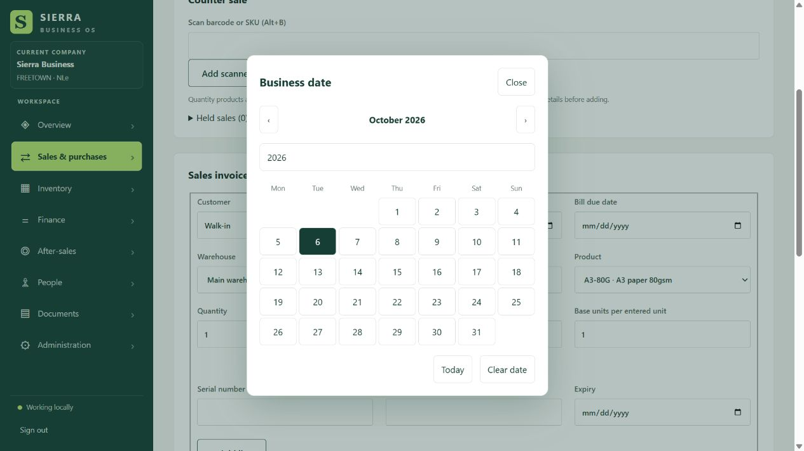

# Form picker fix — 0.27.1

The user reported that product dropdowns and date calendars would not open in the
Windows application despite existing catalogue products. Earlier browser checks
using programmatic selection did not establish whether native popup windows opened
in the MAUI host.

All single-choice dropdowns and date inputs now use an in-page picker, loaded by
both the browser and MAUI shells. Dropdowns list the original field's choices and
support search, keyboard selection and cancellation. The calendar supports month
navigation, year entry, date selection and clearing optional dates. It preserves
date limits and disabled/read-only controls. Choices dispatch the original change
events so existing Blazor bindings and business validation still apply. The sales
and receipt business date is explicitly required and cannot be cleared through
the picker. Packaging checks now require `wwwroot/forms.js` in the native output.

## Verification on 6 October 2026

Actual mouse/keyboard interaction in an isolated SQLite company verified:

- Catalogue tracking dropdown opened and the product `A3-80G` saved at NLe 500.
- Product search and clicking the product choice selected it on the invoice.
- Business, due and expiry calendars opened. Month navigation and day selection
  updated the fields; expiry appeared on the draft line.
- A receipt for five units at NLe 250 persisted the clicked product, business date
  `2026-10-05` and due date `2026-10-10` in its saved request.
- A cash sale for one unit at NLe 500 persisted the clicked product and business
  date `2026-10-05`.
- Keyboard dropdown opening, search and Enter selection worked; clearing an
  optional due date returned the field to empty.
- The rendered-component regression `ReceiptPickerChangesReachPersistedDocument`
  passed and checks saved product, dates and quantity, plus required business date.
- JavaScript syntax check passed. The earlier web build passed without warnings
  or errors; the final native packaging run is recorded in the package log.

These are direct browser checks of the shared picker code. Native Windows UI
automation is unavailable in this session, so interactive acceptance on the
installed MAUI app remains required. The underlying native-popup failure was not
independently reproduced in that host; the fix avoids that popup path entirely.

## Installer

Built `artifacts/windows/0.27.1/SierraBusiness-Setup-x64.exe` on 6 October 2026:
285,041,909 bytes, product version 0.27.1. The full packaging run passed 288 tests
with zero failures and six live-provider skips, offline OCR, native publish and
Inno Setup compilation. The staged `forms.js` matches the source checksum and the
native host HTML loads it. Installer SHA-256 independently verified:
`D0ED1E08AB2BBE98A44358FECB56F2F9A258E0F5DA6A02C1444FA2552832207B`.
Logs are in `artifacts/windows/0.27.1/package-output.log` and `package-errors.log`.
The installer is unsigned and was not installed by this verification run.
