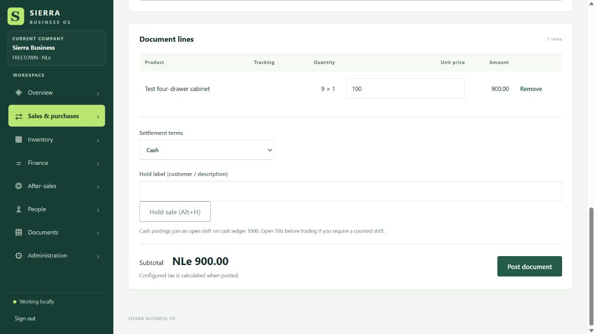
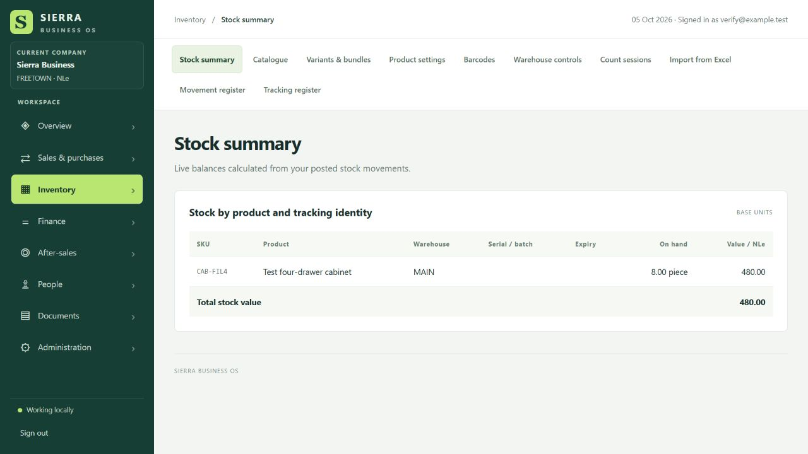

# Functional verification — 5 October 2026

All interactive checks used a separate SQLite database and synthetic records at
`http://127.0.0.1:5298`. No live company transactions were posted.

## Browser checks

| Flow | Observed result |
| --- | --- |
| Sign in | Test owner reached the workspace. |
| Navigation | All 46 available screens opened; all five payroll tabs opened without an application error. This checks navigation, not every action on each screen. |
| Catalogue | Keyboard entry saved SKU and product name. A rendered component test also verifies catalogue inputs reach the saved product. |
| Sales form | SKU search filtered the product selector; selection, quantity, agreed price, Add line and Remove worked. |
| Receipt | Zero purchase cost was rejected. Ten units at NLe 60 posted a NLe 600 receipt. |
| Price policy | Authorized minimum-price save worked. A sale below the minimum was rejected without disclosing the minimum. |
| Held sales | Hold and recall preserved two units at NLe 100. Posting removed the held sale (count returned to zero). |
| Settlement | Cheque and bank-transfer selectors exposed their detail fields. Missing cheque reference blocked posting. Cash sale posted successfully. |
| Persistence | Reload retained the NLe 200 invoice. Stock was eight units worth NLe 480. Financial statements showed NLe 80 profit and a zero balance-sheet difference; trial-balance debit and credit were both NLe 920. |
| Stock protection | Selling nine units with only eight available was rejected. |
| Customer form | Code, name, email, 30-day terms and NLe 1,000 credit limit saved correctly. Edit, credit-hold checkbox, Save and Statement worked. |
| Document library | List view and Search responded with the expected empty test library. |
| Printing | Payment-receipt checkbox changed the document. Print created a preview frame containing the correct NLe 200 receipt. Physical printing/PDF saving was not verified. |

## Automated checks and corrections

The authenticated HTTP workflow script passed, including catalogue, receipt, sale,
retry/replay, reversal, accounting voucher, bank matching/cancellation, cash flow,
warehouse transfer, reservations, delivery/invoicing, return/refund, barcode packs,
held-sale posting, batch/serial count replay, FEFO, till closing and antiforgery rejection.

Corrected its outdated authenticated-workspace text assertion to use the workspace
element. The script now explicitly selects SQLite and disables synchronization,
restoring both environment settings afterward. This keeps verification isolated
even when the caller has configured a different database provider or sync role.

The new `CatalogueInputsReachSavedProduct` rendered-component test passed separately.

The Release integration suite completed with **287 passed, zero failed, six skipped
out of 293 tests** in 10 minutes 57 seconds. The skips were two live SQL Server
tests and four live PostgreSQL tests; their test connections were not configured.

## Acceptance limits

This is representative interactive verification plus automated workflow coverage;
it is not evidence that every control and every input combination has been clicked.
Serial/batch/expiry/date inputs, file import/upload, camera capture, all role-specific
screens and native MAUI host behavior still need dedicated interactive acceptance.
The statement export click produced no application error, but the in-app browser
did not deliver an observable download event; saved workbook delivery remains
unverified. Live SQL Server and PostgreSQL checks require their test connection
configuration. Browser fill helpers can display values without committing Blazor
change bindings; keyboard entry with Tab was used for committed form values.
